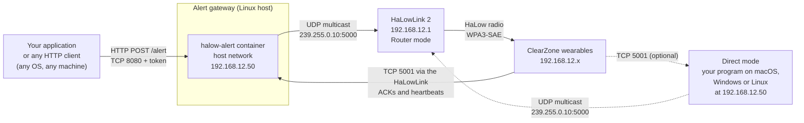

# halow-alert

[](https://github.com/clearobject/halow-alert-releases/actions/workflows/checks.yml)

**Make ClearObject ClearZone HaLow wearables alert from your own software.**

ClearZone wearables (vests and handhelds) vibrate and sound when they receive an alert over a Wi-Fi HaLow (IEEE 802.11ah) network served by a Morse Micro HaLowLink 2. **halow-alert** is a small gateway service that lets any program, such as a simulator, a control application or a test script, trigger them with a single HTTP request, and that reports which wearables acknowledged. Everything runs on your local network: no cloud, no internet connection and no ClearObject Workzone camera system are needed. This repository holds the user documentation, ready-made integrations, the Docker Compose kit and the releases. The service itself ships as the container image `ghcr.io/clearobject/halow-alert`.

> [!NOTE]
> **Version 1.0.0** has been tested in software on Linux, macOS and Windows, against a stand-in wearable that follows the documented protocol. It has not yet been verified with HaLow hardware: the [changelog](CHANGELOG.md) lists the points still to check. If a wearable behaves differently from what these documents describe, please [open an issue](https://github.com/clearobject/halow-alert-releases/issues/new/choose).

## How it works



1. Your software calls `POST /alert` on the **alert gateway**, a Linux machine that is cabled to the HaLowLink.
2. The gateway sends one UDP multicast datagram to `239.255.0.10:5000`. The HaLowLink carries it over the HaLow radio, and **every wearable on that network alerts**.
3. Each wearable reports back over TCP port `5001` with an acknowledgement (ACK). Every 15 s the gateway also asks the wearables for a heartbeat (battery, signal strength), so `GET /wearables` always shows who is reachable.

In **direct mode** there is no gateway: the program that runs on the machine plugged into the HaLowLink sends the multicast datagram itself. It takes a few lines of code in any language.

The [architecture guide](docs/ARCHITECTURE.md) covers the components, message flows, delivery guarantees, failure handling and security model in detail.

## Choose your setup

| | **A. Alert gateway + HTTP API** (recommended) | **B. Direct mode** |
|---|---|---|
| In the integrations | Gateway mode | Direct mode |
| Your software runs on | Any machine and OS that can reach the gateway over your network | The machine plugged into the HaLowLink (macOS, Windows or Linux) |
| Extra hardware | A Linux host next to the HaLowLink: Raspberry Pi 4 or 5 (64-bit OS), NVIDIA Jetson, a mini PC, any amd64 or arm64 Linux box | None |
| Your code does | One HTTP `POST` with a token | Sends one UDP multicast datagram; optionally listens on TCP 5001 for ACKs |
| You get for free | Token check, rate limit, heartbeats, wearable roster, health check, JSONL log, auto-recovery when the HaLowLink is re-plugged | Full control, nothing to install |
| Start with | [Quick start A](#quick-start-a-alert-gateway) | [Quick start B](#quick-start-b-direct-mode) |

Docker Desktop (on macOS, Windows or Linux) and rootless Docker run containers inside their own virtual network and **cannot reach the HaLowLink**. Setup A needs Docker Engine running as root on a Linux host. On a Mac or Windows PC without a Linux host, use setup B.

> [!WARNING]
> The wearables vibrate and sound at full volume. Tell the people nearby before you send an alert.

## Quick start A: alert gateway

On the Linux gateway. You need Docker Engine ([install it](https://docs.docker.com/engine/install/)), and internet access once to download the image. If `docker` says `permission denied` on `/var/run/docker.sock`, run the `docker` commands with `sudo`, or add your user to the `docker` group ([Docker's post-install steps](https://docs.docker.com/engine/install/linux-postinstall/)).

**1. Connect the HaLowLink.** Plug its USB-C into the gateway and wait about 60 s. Then give the gateway its static address `192.168.12.50/24` with [`setup-network-linux.sh`](setup-network-linux.sh), from the kit zip of the [latest release](https://github.com/clearobject/halow-alert-releases/releases) (it uses NetworkManager; [docs/NETWORK.md](docs/NETWORK.md) covers other setups and the LAN port):

```bash
sudo ./setup-network-linux.sh usb
```

**2. Check the path.** This sends nothing to the wearables. Every row should say PASS, with egress address `192.168.12.50` and no `[NOTE]` line:

```bash
docker run --rm --network host ghcr.io/clearobject/halow-alert:1.0.0 doctor
```

**3. Start the service.** First make a long random token: anyone who has it can set off the wearables. Note the token that is printed; the machines that call the API need it.

```bash
HALOW_TOKEN=$(python3 -c 'import secrets; print(secrets.token_urlsafe(24))'); echo "token: $HALOW_TOKEN"

docker run -d --name halow-alert --restart unless-stopped --network host \
  -e HALOW_TOKEN="$HALOW_TOKEN" -e HALOW_IFACE=192.168.12.50 \
  -v halow-alert-data:/data \
  ghcr.io/clearobject/halow-alert:1.0.0
```

That one `docker run` is the whole service. `--restart unless-stopped` restarts it if it fails, and starts it again whenever Docker starts, so it comes back after a reboot as long as Docker starts at boot (`sudo systemctl enable docker`; Docker Engine's packages for Ubuntu, Debian and Raspberry Pi OS do that already). `--network host` is required: the multicast has to leave through the host's HaLowLink interface. The service looks up the HaLowLink address on every request, so it needs no restart when the HaLowLink is plugged in after it.

| To | Run |
|---|---|
| Check that it runs | `docker ps --filter name=halow-alert` says `(healthy)` about 30 s after the start |
| See its output | `docker logs -f halow-alert` |
| Show the token again | `docker exec halow-alert printenv HALOW_TOKEN` |
| Read the log of alerts, ACKs and heartbeats | `docker exec halow-alert tail -n 20 /data/halow-alert.jsonl` |
| Stop it, start it again | `docker stop halow-alert`, `docker start halow-alert` |
| Change a setting, or move to a new version | `docker rm -f halow-alert`, then the `docker run` above with the new setting or image tag. The log volume stays. |
| Remove it | `docker rm -f halow-alert && docker volume rm halow-alert-data` |

The settings are environment variables (`-e NAME=value`), listed in the [HTTP API reference](docs/HTTP-API.md#service-settings).

**With Docker Compose instead**, in the unpacked kit (Docker's Compose plugin is needed). The kit's [`docker-compose.yml`](docker-compose.yml) runs the same service and writes its log to `./data/halow-alert.jsonl`:

```bash
echo "HALOW_TOKEN=$(python3 -c 'import secrets; print(secrets.token_urlsafe(24))')" > .env
docker compose up -d
docker compose ps        # "healthy" after about 30 s
grep HALOW_TOKEN .env    # the token: give it to the machines that call the API
```

Compose runs the container as uid and gid 1000 (the first user on Ubuntu, Jetson and Raspberry Pi OS) so that it can write to `./data`. If `id -u` or `id -g` print something else, add `HALOW_UID=<uid>` and `HALOW_GID=<gid>` to `.env`, as [`.env.example`](.env.example) shows. Keep `.env` out of version control and shared documents.

**Trigger an alert** from any machine that can reach the gateway. First set the token from the gateway's `.env` there (`export HALOW_TOKEN=<token>`; in PowerShell `$env:HALOW_TOKEN='<token>'`):

```bash
curl -X POST http://<gateway>:8080/alert \
     -H "Authorization: Bearer $HALOW_TOKEN" \
     -H "Content-Type: application/json" \
     -d '{"label": "zone-3 intrusion"}'

curl http://<gateway>:8080/wearables   # who answered: ACK counts, battery, signal strength
curl http://<gateway>:8080/health      # 200 when the gateway can send, 503 when it cannot
```

On Windows PowerShell, call `curl.exe` (plain `curl` is an alias for a different command), or use `Invoke-RestMethod`. Allow TCP 8080 from your client machines and TCP 5001 from `192.168.12.0/24` in the gateway's firewall ([how](docs/NETWORK.md#firewall)). The [HTTP API reference](docs/HTTP-API.md) documents every field and status code. To call the gateway from Python, see [Use it from Python](#use-it-from-python).

## Quick start B: direct mode

1. Give the machine that is plugged into the HaLowLink the static address `192.168.12.50/24`, with no gateway: [Linux, macOS and Windows steps](docs/NETWORK.md#set-the-address).
2. Send the alert from your code. In Python, for example:

   ```python
   import socket, struct, time
   s = socket.socket(socket.AF_INET, socket.SOCK_DGRAM)
   s.setsockopt(socket.IPPROTO_IP, socket.IP_MULTICAST_IF, socket.inet_aton("192.168.12.50"))
   s.setsockopt(socket.IPPROTO_IP, socket.IP_MULTICAST_TTL, 4)
   s.sendto(struct.pack("<d", time.time()), ("239.255.0.10", 5000))   # 8 bytes: little-endian double, Unix seconds
   ```

3. Optionally, to learn which wearables acknowledged, accept TCP connections on port 5001 and decode the reply. Allow TCP 5001 from `192.168.12.0/24` in your firewall.

The [integrations](integrations/README.md) contain complete, tested examples for both modes, and the [wire protocol](docs/PROTOCOL.md) documents every byte.

## Use it from Python

The Python client, `halow_client`, needs Python 3.8 or later and nothing else. Install it from the release into a virtual environment (the [Python client guide](integrations/python/README.md#install) shows the other ways, and the Windows commands):

```bash
python3 -m venv .venv && . .venv/bin/activate
python -m pip install https://github.com/clearobject/halow-alert-releases/releases/download/v1.0.0/clearobject_halow_client-1.0.0-py3-none-any.whl
```

**Through the gateway** (setup A), from any machine that can reach it:

```python
from halow_client import GatewayClient, HalowError

gw = GatewayClient("http://<gateway>:8080", token="<token>")   # or set HALOW_URL and HALOW_TOKEN
try:
    gw.alert(label="zone-3 intrusion")      # every wearable on the HaLowLink alerts now
except HalowError as e:                     # e.status: 401 wrong token, 429 less than 0.5 s since the last alert, ...
    print("alert failed:", e)
print(gw.wearables()["devices"])            # who answered: ACKs, battery, signal strength
```

**Directly** (setup B), on the machine that is plugged into the HaLowLink:

```python
from halow_client import ResponseListener, send_direct, subnet_prefix

egress = "192.168.12.50"                    # this machine's address on the HaLowLink
with ResponseListener(5001, allow_prefix=subnet_prefix(egress)) as replies:
    record = send_direct(egress)            # every wearable on the HaLowLink alerts now
    print(replies.wait_for("ACK", timeout=15, after_ms=record["ts_ms"]))   # a wearable's ACK, or None
```

Complete programs to start from:

| Example | What it shows |
|---|---|
| [`example.py`](integrations/python/example.py) | One alert, then waiting for a wearable's ACK, through the gateway or directly (`--direct`) |
| [`examples/alert_from_your_app.py`](integrations/python/examples/alert_from_your_app.py) | Alerts from inside your own program loop, such as a simulator: sent on a background thread so the loop never waits, once per event, with a retry when the gateway answers `429` |
| [`examples/wearable_status.py`](integrations/python/examples/wearable_status.py) | A check before a session: can the gateway send, and which wearables answer, with battery and signal strength. Nothing buzzes. |

The [Python client guide](integrations/python/README.md) documents every function and the `halow-client` command. JavaScript, C# and curl clients are in [`integrations/`](integrations/README.md).

**No hardware yet?** [`tools/fake_wearable.py`](tools/fake_wearable.py) is a stand-in wearable (Python 3.8+, no dependencies) that answers alerts and heartbeat requests like the real one, over loopback, so you can develop and test your integration on your own machine. [Try it without hardware](integrations/README.md#try-it-without-hardware) gives the exact commands for Linux, macOS and Windows, for direct mode and for the gateway image. It follows the documented protocol; it does not prove the real wearable's behaviour.

## Requirements

| Item | Value |
|---|---|
| HaLowLink 2 | Router with HaLow Access Point mode (the factory default), `192.168.12.1/24`. ClearObject sets it up and joins the wearable to it before handover. |
| Link to the HaLowLink | Its USB-C port (one cable, also powers it) or its **LAN** port. Never the WAN port, and never connect the LAN port to another network. |
| Address on the HaLowLink side | **`192.168.12.50/24`, static, no gateway**, on the gateway (setup A) or on your machine (setup B) |
| Alerts | UDP multicast **out** to `239.255.0.10:5000` (multicast TTL 1 or more) |
| Wearable replies | TCP **in** on port `5001`, from `192.168.12.0/24` |
| HTTP API (setup A) | TCP **in** on port `8080`, from your client machines |
| Gateway host (setup A) | Linux on amd64 or arm64, Docker Engine running as root with host networking. Not Docker Desktop, not rootless Docker. 32-bit ARM is not supported. |
| Internet | Not needed (only once, to download the image) |
| VPN | Must not route `192.168.12.0/24`. See [VPNs](docs/NETWORK.md#vpns). |

## Documentation

| Guide | What it covers |
|---|---|
| [Architecture](docs/ARCHITECTURE.md) | Components, message flows, delivery semantics, failure modes, security model, logs |
| [Network setup](docs/NETWORK.md) | USB-C or LAN port; the static address on Linux, macOS and Windows; firewall; VPNs |
| [HTTP API](docs/HTTP-API.md) | `POST /alert`, `GET /wearables`, `GET /health`, status codes, service settings. Machine-readable: [openapi.yaml](docs/openapi.yaml) |
| [Wire protocol](docs/PROTOCOL.md) | The UDP alert and the TCP replies byte by byte, and what is verified on hardware |
| [Troubleshooting](docs/TROUBLESHOOTING.md) | `doctor`, common symptoms, what to include in a bug report |

## Integrations and kit files

| Path | What it is |
|---|---|
| [`integrations/`](integrations/README.md) | Ready-made clients for your software, for both setups |
| [`integrations/python/`](integrations/python/) | Python 3.8 or later: one file to copy, or the package `clearobject-halow-client` for pip, with the `halow-client` command, and [examples](integrations/python/examples/) |
| [`integrations/javascript/`](integrations/javascript/) | JavaScript (Node.js 18 or later) |
| [`integrations/csharp/`](integrations/csharp/) | C# (.NET 8 or later; the library also builds for .NET Standard 2.1, so Unity 2021.2 or later) |
| [`integrations/curl/`](integrations/curl/) | A curl script, and curl and PowerShell one-liners (gateway mode) |
| [`tools/fake_wearable.py`](tools/fake_wearable.py) | Stand-in wearable for development without hardware |
| [`docker-compose.yml`](docker-compose.yml) | Runs the gateway service from the published image |
| [`.env.example`](.env.example) | The settings `docker-compose.yml` reads from `.env` |
| [`setup-network-linux.sh`](setup-network-linux.sh) | Gives a Linux host the address `192.168.12.50/24` on the HaLowLink (NetworkManager) |

## Versions and releases

The image `ghcr.io/clearobject/halow-alert` is public (no login needed) and built for `linux/amd64` and `linux/arm64`.

| Image tag | Points to | Use it for |
|---|---|---|
| `1.0.0` (`X.Y.Z`) | One exact release; never moved | Anything you depend on. The kit's `docker-compose.yml` pins it. |
| `1.0` (`X.Y`) | The newest patch release of `X.Y` | Picking up fixes automatically |
| `latest` | The newest release | Quick trials only |

Each [GitHub release](https://github.com/clearobject/halow-alert-releases/releases) attaches the kit as a zip (documentation, integrations, Compose file, network setup script and stand-in wearable) with its SHA-256 checksum, and the Python client package for pip as a wheel and an sdist, each with its SHA-256 checksum ([how to install it](integrations/python/README.md#install)). The project follows [Semantic Versioning](https://semver.org/): within 1.x, no release breaks the HTTP API, the settings or the Python client's functions, and the [changelog](CHANGELOG.md) always says what changed.

## Support

- Questions and bug reports: [open an issue](https://github.com/clearobject/halow-alert-releases/issues/new/choose) in this repository. **Never paste tokens, passwords or HaLow network passphrases.**
- The wearable or HaLowLink hardware (powering, charging, silencing an alarm, passwords): your ClearObject contact.
- Security vulnerabilities: report them privately, as described in [SECURITY.md](SECURITY.md).

More in [SUPPORT.md](SUPPORT.md). About ClearObject: [www.clearobject.com](https://www.clearobject.com).

## License

Copyright (c) 2026 ClearObject. All rights reserved. In short:

- **Documentation** in this repository may be read, copied and shared. The code examples in the documentation, and `docs/openapi.yaml`, may also be used, copied and changed under the MIT License.
- **Code** in [`integrations/`](integrations/) and [`tools/`](tools/) is under the MIT License ([`integrations/LICENSE`](integrations/LICENSE)).
- **The container image** may be used free of charge to operate ClearObject HaLow wearables. It may not be redistributed or included in another product without ClearObject's written permission. Third-party components in it, such as the Debian base system and Python, stay under their own licenses.
- **Kit files** (`docker-compose.yml`, `.env.example`, `setup-network-linux.sh`) may be used, copied and changed to run the image.

The full terms are in [LICENSE](LICENSE). Product names of other companies are trademarks of their respective owners.
