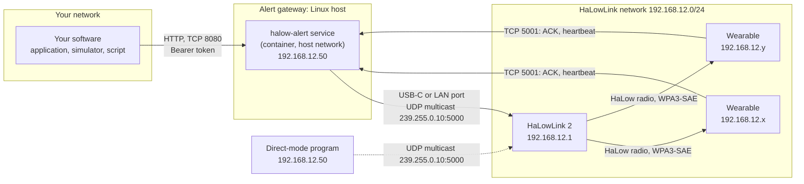
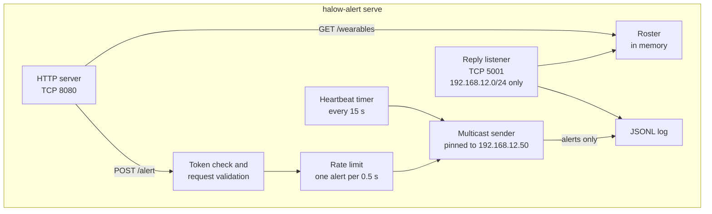
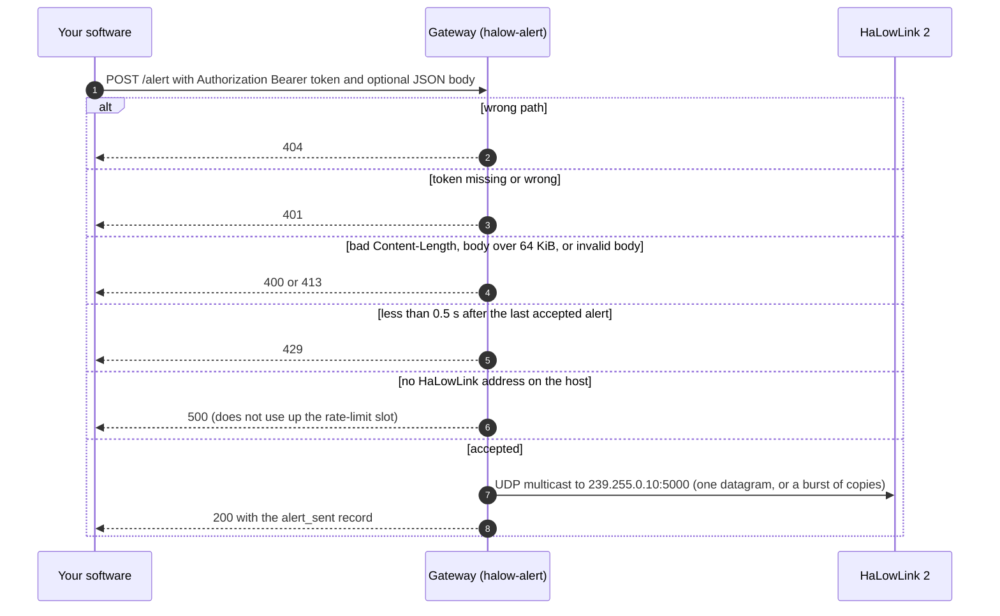
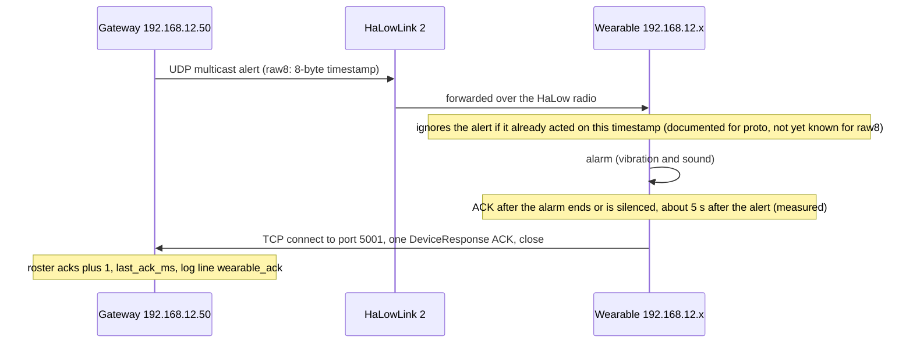
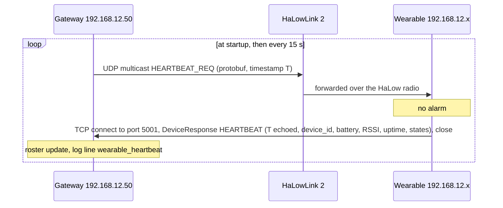

# Alerting architecture

This guide explains how an alert travels from your software to a ClearZone wearable and back, what each part is responsible for, what the system guarantees and what it does not, how it behaves when something fails, and how it is secured. For setup steps, start with the [README](../README.md).

## Contents

- [Overview](#overview)
- [Components](#components)
- [Inside the gateway service](#inside-the-gateway-service)
- [Addresses and ports](#addresses-and-ports)
- [Message flows](#message-flows)
- [Delivery semantics](#delivery-semantics)
- [Failure modes](#failure-modes)
- [Security model](#security-model)
- [What the gateway logs](#what-the-gateway-logs)
- [Verified and inferred](#verified-and-inferred)

## Overview



There are two ways to drive the wearables:

- **Setup A, alert gateway.** A Linux host is cabled to the HaLowLink and runs the halow-alert container. Your software, on any machine and operating system, calls its HTTP API. The gateway takes care of the network details, the wearable replies and recovery.
- **Setup B, direct mode.** Your program runs on the machine that is plugged into the HaLowLink, and sends the UDP multicast itself. Optionally it also accepts the wearable replies on TCP 5001. This works on macOS and Windows, where the container cannot reach the HaLowLink.

Both send the same bytes. Everything stays on the local link: no part of the system needs the internet or a cloud service.

## Components

| Component | Where it runs | Responsibilities |
|---|---|---|
| **Your software** | Any machine that can reach the gateway | Decides when to alert. Calls `POST /alert`. May poll `GET /wearables` and `GET /health`. |
| **Alert gateway host** | Linux (amd64 or arm64), cabled to the HaLowLink by USB-C or its LAN port | Holds the static address `192.168.12.50/24` on the HaLowLink interface, with no default route. Runs Docker Engine as root. |
| **halow-alert service** | The `serve` command of the container, with host networking | Checks the token and the request. Enforces the rate limit. Encodes the alert and multicasts it from `192.168.12.50`. Sends a heartbeat request every 15 s. Accepts wearable replies on TCP 5001. Keeps a roster of wearables. Reports its health. Writes a JSONL log. |
| **HaLowLink 2** | Morse Micro router, Router with HaLow Access Point mode | Serves `192.168.12.0/24` and hands out addresses to the wearables (DHCP). Bridges its LAN, USB-C and HaLow interfaces, which carries the multicast onto the radio. Runs the HaLow access point (WPA3-SAE). |
| **ClearZone wearables** | On the HaLow network, `192.168.12.x` | Listen for the alert group. Alarm (vibration and sound) on an alert, and drop repeats of an alert they already acted on (documented for `proto`, not yet known for `raw8`). Answer with an ACK, and answer heartbeat requests, over TCP 5001. |
| **Direct-mode program** | The machine plugged into the HaLowLink, at `192.168.12.50` | Does the gateway's network job itself: the multicast, and optionally the TCP 5001 listener. |

ClearObject sets up the HaLowLink (its mode and its HaLow network) before handover, or sends a settings file that does it ([how to load it](NETWORK.md#load-a-settings-file-from-clearobject)). The wearable is already set up for that HaLow network.

## Inside the gateway service



- The sender sets the outgoing multicast interface (`IP_MULTICAST_IF`) to the gateway's HaLowLink address on every socket, so it never depends on the multicast routing table.
- The service looks up that address **on every request and every heartbeat**. When the HaLowLink is unplugged, or boots after the service, the service reports the problem and recovers by itself once the address is back. No restart is needed.
- With `HALOW_IFACE` set (the quick start's `docker run` and the Compose kit set `192.168.12.50`), that exact address must be present on the host. Without it, the service picks the local address the host uses to reach `192.168.12.1`, and accepts it only if it is on `192.168.12.x`.
- The roster lives in memory and starts empty when the service restarts. The JSONL log persists.

## Addresses and ports

| What | Address | Port and protocol | Direction, from the gateway | Notes |
|---|---|---|---|---|
| HaLowLink 2 | `192.168.12.1/24` | HTTPS 443 (admin page) | out | Only `doctor` touches it, to check reachability. |
| Gateway, HaLowLink side | `192.168.12.50/24`, static, no gateway | | | The sender address. Outside the HaLowLink's DHCP range. |
| Wearables | `192.168.12.x` (DHCP) | | | |
| Alert group | `239.255.0.10` | UDP 5000 | out | Alerts and heartbeat requests. Multicast TTL 4 (1 is enough). |
| Wearable replies | the gateway | TCP 5001 | in, from `192.168.12.0/24` | One reply per TCP connection. |
| HTTP API | the gateway, your network side | TCP 8080 | in, from your clients | `Authorization: Bearer <token>` on `POST /alert`. |
| Multicast route | `239.0.0.0/8` via the HaLowLink interface | | | Optional; added by `setup-network-linux.sh` for other programs. |

All of these except the HTTP port and the token are fixed by the wearables' configuration. Change them only if ClearObject tells you to. The service settings are listed in the [HTTP API reference](HTTP-API.md#service-settings).

## Message flows

### Your software to the gateway

The service checks a request in this order, and answers at the first problem:



The `200` comes back as soon as the datagram is sent, or when the burst ends if you asked for one. It does **not** wait for the wearables' ACKs; read those from `GET /wearables`.

### Alert, alarm and ACK



The ACK's `timestamp` is the moment the wearable **received** the alert, by the wearable's clock, in whole Unix seconds on the wearable tested on hardware. The alert itself arrives within a second: in the hardware test, the wearable received it in the same second it was sent. The ACK's arrival at the gateway also includes the alarm sequence, so it comes about 5 s after the alert (5.04 to 5.14 s in the test). The gateway's `200` does not wait for it.

### Heartbeat request and heartbeat



Because the heartbeat echoes the request's timestamp, "now minus `timestamp_ms`" is a round-trip time that needs no clock synchronisation.

## Delivery semantics

| Property | Behaviour | Status |
|---|---|---|
| Transport | UDP multicast: no connection, no delivery confirmation from the network. | By design |
| Fan-out | Every wearable on the HaLow network alerts, except that in the hardware test wearables on their charging dock did not respond (see [Failure modes](#failure-modes)). The protocol has no way to address a single wearable. | Verified on hardware |
| Speed | The alert reaches the wearables within a second: in the hardware test, the wearable received each alert in the same second it was sent, and a heartbeat request and its reply took 30 to 80 ms. Only the ACK takes about 5 s (see below). | Verified on hardware |
| What `200` means | The datagram left the gateway towards the HaLowLink. It does not mean that a wearable alarmed. | Verified in software |
| Retransmission | None by default. With `burst_seconds` (at most 5), the gateway re-sends the **identical** datagram every 100 ms until that many seconds have passed: about 10 copies per second. It rides out radio loss. | Verified in software |
| Duplicates | A wearable ignores an alert whose timestamp it has already acted on, so the copies of a burst should alarm once. Documented for the `proto` format. For `raw8` (the default) and for `both`, not yet known. | Documented / Unknown |
| Clock | The alert carries the gateway's clock. Keep it moving forward: an alert stamped earlier than the last one a wearable acted on may be ignored, for example after the clock is set back. | Inferred |
| Evidence of delivery | The wearable's ACK over TCP 5001. It arrives after the alarm ends or is silenced, about 5 s after the alert ([measurements](PROTOCOL.md#timing-of-acks)), so allow 15 s. Use `last_ack_ms` and `acks` in `GET /wearables`. | Verified on hardware (the ACK and its timing) |
| Matching ACKs to alerts | ACKs carry no alert ID and no device ID. Identify the wearable by its IP address (heartbeats map the address to a `device_id`), and match by time: the ACKs that arrive after alert N and before alert N+1 belong to alert N. | Verified against the schema |
| ACK destination | The wearable connects back to the address the alert came from. Use `192.168.12.50`, the address ClearObject's own systems send from. Whether the wearables reply to a fixed address instead is not yet verified: in the hardware test, the alerts were sent from `192.168.12.50` and the ACKs came back there, which fits either. | Inferred |
| Rate limit | One accepted alert per 0.5 s; sooner requests get `429` and are not sent. Failed requests and the copies inside a burst do not count. The ClearObject Workzone system uses the same limit. In direct mode, keep to it yourself. | Verified in software |
| Liveness | Heartbeat requests every 15 s keep `last_seen_ms` current. Treat a wearable as offline after 60 s without a reply, as the ClearObject Workzone system does. | Verified in software |
| State | The roster is in memory and is lost on restart. The JSONL log is the durable record. | Verified in software |

## Failure modes

| What happens | What the gateway does | What you see | Status |
|---|---|---|---|
| **HaLowLink unplugged, rebooting or still booting** | The address `192.168.12.50` disappears from the host. Each request and each heartbeat looks it up again and fails. | `GET /health` returns `503` with the reason. `POST /alert` returns `500` (it does not use up the rate-limit slot). The container turns `unhealthy` after about 90 s and keeps running. | Verified in software |
| **HaLowLink plugged back in** | NetworkManager re-applies the `halow` profile (autoconnect); the next request finds the address again. | `/health` returns `200`, alerts go out, heartbeats resume. No restart needed. | By design, not yet on hardware |
| **Gateway host reboots** | Docker restarts the container (`restart: unless-stopped`); NetworkManager restores the address. | The service is back without manual steps. | By design, not yet on hardware |
| **No internet, WAN offline** | Nothing changes. Every part runs on the local link. | Nothing. | By design |
| **Wearable off, out of range, not joined, or battery flat** | The alert is still sent. | `POST /alert` returns `200`, but no ACK arrives, and the wearable's `last_seen_ms` stops advancing. | Verified in software |
| **Wearable on its charging dock** | The alert is still sent. | No ACK: in the hardware test, wearables on their charging dock did not respond to alerts, although they kept answering heartbeat requests, so `last_seen_ms` keeps advancing while `acks` does not. Take the wearable off the charger. | Verified on hardware (the wearables' behaviour; the gateway was not part of the test) |
| **Radio loss of one datagram** | Nothing, unless you asked for a burst. | No alarm and no ACK. Send again, or use `burst_seconds` (for example `1`). | By design |
| **Alerts faster than 0.5 s** | The later one is refused. | `429`; retry after 0.5 s if the first alert does not cover it. | Verified in software |
| **TCP 5001 already taken at startup** (another listener on the host) | The service exits with code 2: `Address already in use`. Docker restarts it until the port is free. | The container keeps restarting. | Verified in software |
| **Reply listener stops** | Keeps serving HTTP. | `/health` returns `503`: "the wearable response listener stopped; restart the service". | By design |
| **A VPN or another network owns `192.168.12.0/24`** | Alerts may still leave (the interface is pinned), but replies are routed into the VPN. | No ACKs or heartbeats; `doctor` fails its `egress address` or `route to HaLowLink` row. See [VPNs](NETWORK.md#vpns). | By design |
| **A host outside `192.168.12.0/24` connects to TCP 5001** | Closes the connection unread. | A `wearable_rejected` log line, at most once a minute per address. | Verified in software |
| **Malformed or unexpected reply** | Ignores it and prints one line; the listener keeps running. | Nothing in the roster. | Verified in software |
| **Overload** | More than 64 HTTP connections at once, or more than 32 replies in flight: the extra connections are closed. Idle HTTP clients are dropped after 10 s. | Connection closed without a response. | By design |

## Security model

**Two trust boundaries.**

1. **The HTTP API (setup A).** `POST /alert` needs `Authorization: Bearer <token>`. The service refuses to start on anything but `127.0.0.1` without a token (unless you explicitly pass `--allow-no-token`), and refuses the placeholder token `CHANGE-ME`. The token is compared in constant time and never logged. `GET /health` and `GET /wearables` need no token; they reveal wearable addresses, device IDs, battery and signal strength to anyone who can reach the port. The API speaks plain HTTP, so the token is visible on the wire: use it on a network you trust, and allow TCP 8080 only from your client machines in the host firewall. If you need encryption, put a TLS reverse proxy on the gateway in front of it. The API sends no CORS headers, so a web page in a browser cannot call it with your token. Without a token (a gateway on `127.0.0.1`, or `--allow-no-token`), none is needed: any program on that machine (with `--allow-no-token`, on any machine that can reach the port), and any web page open in a browser that can reach the port, can send a plain `POST /alert` and set off the wearables. Keep a token whenever a browser runs on a machine that can reach the API.
2. **The HaLowLink network (`192.168.12.0/24`).** The alert protocol itself has **no authentication**: anything on that network can send the multicast and set off every wearable. Access to it is controlled by:
   - the HaLow radio, which uses WPA3-SAE with a passphrase that ClearObject sets (on the HaLowLink before handover, or in the settings file it sends you);
   - physical access to the HaLowLink's USB-C and LAN ports. Never connect the LAN port to another network;
   - the HaLowLink's 2.4 GHz Wi-Fi access point, which the kit does not use. Keep it off.

   Keep the HaLowLink admin password and the HaLow network passphrase private. Never put them in an issue, a repository or a shared document.

**Further protections.**

- Wearable replies are accepted only from `192.168.12.0/24`. Other peers are disconnected unread and logged as `wearable_rejected`.
- Replies are read for at most 5 s and 8 KiB each. HTTP request bodies are limited to 64 KiB. Text received from the network is printed with control characters escaped.
- The container runs as a non-root user. It needs host networking (for the multicast) but no extra privileges or capabilities.
- No cloud, no telemetry, no outbound connections other than to the HaLowLink network.

See [SECURITY.md](../SECURITY.md) for how to report a vulnerability.

## What the gateway logs

**The JSONL log.** One JSON object per line, appended to the file named by `HALOW_LOG`. The container writes `/data/halow-alert.jsonl`, which the quick start's `docker run` keeps in the volume `halow-alert-data` and the Compose kit maps to `./data/halow-alert.jsonl` next to `docker-compose.yml`. The service opens the file for each line, so you can move or delete it at any time; the next event starts a new file. Nothing rotates it for you. One wearable answering heartbeats every 15 s adds roughly 1.4 MB a day.

| `event` | When | Fields |
|---|---|---|
| `alert_sent` | An alert was sent (API or CLI) | `ts_ms` (send time, ms since the Unix epoch), `source` (`http:<caller-ip>:<label>` for the API, `cli` for the `send` command), `format` (`raw8`, `proto` or `both`), `group` (`239.255.0.10:5000`), `egress` (the sending address), `datagrams` (number sent, including burst copies) |
| `wearable_ack` | A wearable ACKed | `ts_ms` (arrival time at the gateway), `ip` (the wearable), `timestamp_ms` (when the wearable received the alert, by its clock, as the wearable sent it: whole Unix seconds on the wearable tested on hardware, despite the name), `code` (`ACK`), `ack_success` |
| `wearable_heartbeat` | A wearable answered a heartbeat request | `ts_ms`, `ip`, `timestamp_ms` (the request's timestamp, echoed), `code` (`HEARTBEAT`), `heartbeat` (`device_id`, `battery_percentage`, `rssi`, `uptime_seconds`, `app_state`, `device_state`) |
| `wearable_rejected` | A host outside `192.168.12.0/24` connected to TCP 5001 | `ts_ms`, `ip` (at most once a minute per address) |

Example lines:

```json
{"event":"wearable_heartbeat","ts_ms":1795111195031,"ip":"192.168.12.143","timestamp_ms":1795111194990,"code":"HEARTBEAT","heartbeat":{"device_id":"wz-07","battery_percentage":87,"rssi":-62,"uptime_seconds":3615,"app_state":1,"device_state":2}}
{"event":"alert_sent","ts_ms":1795111196804,"source":"http:192.0.2.10:zone-3 intrusion","format":"raw8","group":"239.255.0.10:5000","egress":"192.168.12.50","datagrams":1}
{"event":"wearable_ack","ts_ms":1795111201874,"ip":"192.168.12.143","timestamp_ms":1795111196,"code":"ACK","ack_success":true}
```

From these you can measure the **ACK delay** (`ts_ms` of `wearable_ack` minus `ts_ms` of `alert_sent`: the alarm sequence plus the network, about 5 s) and, if the wearable's clock agrees with the gateway's, the **delivery latency**, to the second only (`timestamp_ms` of `wearable_ack`, in whole seconds as the wearable tested on hardware sent it, minus `ts_ms` of `alert_sent` divided by 1000 and rounded down: the radio path; `0` means the wearable received the alert in the second it was sent). In the example, both are 1795111196, and the ACK arrived 5.07 s after the alert.

**The container output** (`docker logs halow-alert`, or `docker compose logs` with the Compose kit):

- standard output: the start-up line (listen address, token required or not, group, sending address), one line per ACK and heartbeat and a line for a rejected connection, at most once a minute per address (`--quiet` turns these off), one line per reply it cannot decode or ignores (even with `--quiet`), and a `WARNING` at start-up when the HaLowLink address is missing;
- standard error: one access line per HTTP request, such as `http 192.0.2.10 "POST /alert HTTP/1.1" 200 -` (also turned off by `--quiet`), and errors such as `heartbeat request failed: ...`.

Not logged anywhere: tokens, request headers, heartbeat requests sent, and request bodies other than the label.

## Verified and inferred

The status words used in this guide:

| Status | Meaning |
|---|---|
| **Verified on hardware** | Seen with real wearables: in production use with the ClearObject Workzone system, or in the hardware test of halow-alert 1.0.0 on 2026-11-24 (the [changelog](../CHANGELOG.md) lists what it covered). |
| **Verified against the schema** | Checked against ClearObject's protocol definitions and their byte-level tests. |
| **Verified in software** | halow-alert 1.0.0 behaviour, tested over loopback against the stand-in wearable. This behaviour has not yet been tested on HaLow hardware. |
| **Documented** | Stated by ClearObject's operator app and protocol definitions; not yet measured with halow-alert. |
| **Inferred** | Follows from code and simulators; not proven on hardware. |
| **Unknown** | Open; to be measured during hardware verification. |
| **By design** | Follows from the architecture; not yet tested end to end on hardware. |

The [wire protocol](PROTOCOL.md#verified-vs-inferred) has the full table for every protocol claim, with its evidence.
