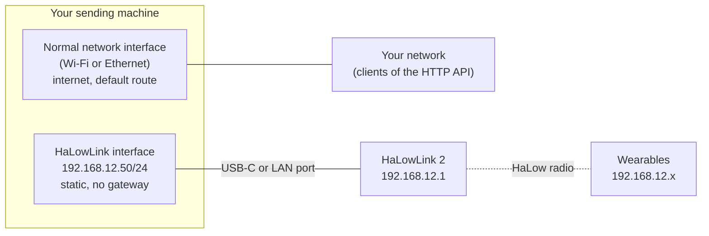

# Network setup

This guide connects the HaLowLink 2 to the machine that sends the alerts (the Linux alert gateway in setup A, or your own machine in setup B) and gives that machine its address on the HaLowLink network. It takes about five minutes.

## Contents

- [What you set up](#what-you-set-up)
- [Before you start](#before-you-start)
- [Connect the HaLowLink](#connect-the-halowlink)
- [Set the address](#set-the-address): [Linux](#linux-with-networkmanager-recommended), [Linux without NetworkManager](#linux-without-networkmanager), [macOS](#macos), [Windows](#windows)
- [Firewall](#firewall)
- [Check the setup](#check-the-setup)
- [VPNs](#vpns)
- [Rules for the HaLowLink](#rules-for-the-halowlink)
- [Why a static address without a gateway](#why-a-static-address-without-a-gateway)

## What you set up



| Setting | Value |
|---|---|
| Address | `192.168.12.50` |
| Subnet | `/24` (`255.255.255.0`) |
| Gateway (router) | **none**: leave it empty |
| DNS | none |
| IPv6 | not needed |
| Multicast route | `239.0.0.0/8` on the HaLowLink interface (optional; the gateway and the Python client pin the interface themselves) |

Your machine keeps its normal network connection, with its internet access and default route, for everything else.

## Before you start

ClearObject configures each unit before handover:

- the HaLowLink 2 is in **Router with HaLow Access Point** mode (the factory default), at `192.168.12.1/24`, and serves addresses to the wearables;
- the wearable is joined to the HaLowLink's HaLow network (WPA3-SAE);
- the HaLowLink's 2.4 GHz Wi-Fi access point is off (check this on the admin page, and turn it off if it is on);
- you receive the HaLowLink admin password and the HaLow network details separately.

You do not need to change any of this. The HaLowLink admin page is at `https://192.168.12.1` (HTTPS only; your browser warns about its self-signed certificate). Its **Home** page lists the joined wearables in the **Connected Devices** card, and their `192.168.12.x` addresses in the **Local Network** card.

## Connect the HaLowLink

In Router mode the HaLowLink's **USB-C** port and its **LAN** port are on the same `192.168.12.0/24` network. Use either. Do not use the **WAN** port.

| | USB-C | LAN port (Ethernet) |
|---|---|---|
| Cables | One: it carries the network and powers the HaLowLink | An Ethernet cable, plus the HaLowLink's own USB-C power supply |
| On your machine | A new USB network adapter appears about 60 s after plug-in | Any Ethernet port, or a USB Ethernet adapter |
| Status | Recommended | Supported; documented in the HaLowLink 2 user guide |
| Notes | Use a port that supplies enough power; a powered hub helps if the HaLowLink keeps rebooting. Do not use a USB-A to USB-C adapter (the HaLowLink user guide warns against it). | Connect straight to your machine, or to a small switch that only the HaLowLink and your machine share. |

The USB adapter's name on Linux depends on the distribution: `enx<mac-address>` on Ubuntu and Debian (for example `enx001122334455`), `usb0` or `eth1` on Raspberry Pi OS, names such as `enp0s20f0u1` on Fedora and Arch. `ip -br link` lists it. On macOS and Windows it appears as a USB Ethernet adapter; this has not been tested yet. If no adapter appears on a Mac or a Windows PC, use the LAN port with an Ethernet port or a USB Ethernet adapter.

When the HaLowLink is unplugged or reboots, the adapter disappears, and it comes back under the same name.

> [!CAUTION]
> **Never connect the HaLowLink's LAN port to a building, office or lab network.** The HaLowLink runs a DHCP server on its LAN side. It would hand out `192.168.12.x` addresses, with itself as the gateway, to other machines on that network and disrupt them. To let other machines trigger alerts, use the alert gateway's HTTP API (setup A). Only the WAN port may ever go to an existing network, and the kit does not need it.

## Set the address

### Linux with NetworkManager (recommended)

Ubuntu Desktop, Debian with a desktop, Raspberry Pi OS (Bookworm and later, including Lite), NVIDIA Jetson and Fedora use NetworkManager by default. Ubuntu Server and minimal Debian do not; see [the next section](#linux-without-networkmanager). [`setup-network-linux.sh`](../setup-network-linux.sh) creates a persistent profile for the HaLowLink:

```bash
sudo ./setup-network-linux.sh usb          # HaLowLink on USB-C
sudo ./setup-network-linux.sh eth eth1     # HaLowLink LAN port -> this Ethernet interface (use your interface name)
./setup-network-linux.sh show              # what is configured now
sudo ./setup-network-linux.sh remove       # undo: delete the profile
```

It creates the NetworkManager profile `halow` with:

- the address `192.168.12.50/24`;
- `ipv4.never-default yes`, so it never takes the default route, and your internet traffic stays on your normal interface;
- the route `239.0.0.0/8`;
- IPv6 off;
- autoconnect on, so the address comes back after a reboot or a re-plug.

It ends by pinging the HaLowLink and printing `HaLowLink 192.168.12.1 answers`.

`usb` picks the only USB-attached, non-wireless network adapter, whatever its name. It changes nothing and stops when:

- it finds no USB network adapter (is the HaLowLink plugged in and booted?);
- it finds several, for example a USB Ethernet dongle or a dock. It lists them; run `sudo ./setup-network-linux.sh eth <interface>` with the HaLowLink's adapter, which is the one that appears when you plug the HaLowLink in;
- the adapter carries this machine's default route through something other than the HaLowLink, which means it is probably your uplink.

`eth` makes the same default-route check. Optional environment variables: `HALOW_ADDR` (default `192.168.12.50/24`), `HALOW_ROUTER` (default `192.168.12.1`), and `HALOW_FORCE=1` to use an interface that carries the default route anyway. Put them after `sudo`, which drops variables set before it: `sudo HALOW_FORCE=1 ./setup-network-linux.sh eth eth1`.

### Linux without NetworkManager

These commands take effect at once but do not survive a reboot or a re-plug. Use your adapter's name:

```bash
sudo ip addr add 192.168.12.50/24 dev enx001122334455
sudo ip link set enx001122334455 up
sudo ip route add 239.0.0.0/8 dev enx001122334455
```

On Ubuntu Server (netplan), make it persistent, including after a re-plug, with `/etc/netplan/60-halow.yaml` (use your adapter name from `ip -br link`):

```yaml
network:
  version: 2
  ethernets:
    enx001122334455:
      addresses: [192.168.12.50/24]
      dhcp4: false
      dhcp6: false
      optional: true   # do not delay boot while the HaLowLink is unplugged
```

```bash
sudo chmod 600 /etc/netplan/60-halow.yaml && sudo netplan apply
```

No gateway and no routes are needed: halow-alert sends from `192.168.12.50` explicitly. Check the result with [`doctor`](#check-the-setup).

On other systems, put the same values (address `192.168.12.50/24`, no gateway; the route `239.0.0.0/8` is optional) into the distribution's network configuration, such as systemd-networkd or `/etc/network/interfaces`.

### macOS

1. Open **System Settings → Network**. The HaLowLink appears as a new Ethernet service once it has booted.
2. Select it, then **Details… → TCP/IP**.
3. Set **Configure IPv4** to **Manually**, **IP address** to `192.168.12.50`, **Subnet mask** to `255.255.255.0`, and leave **Router** empty.
4. Click **OK**.

From the command line (not yet tested), with the service name from the first command:

```bash
networksetup -listallnetworkservices
sudo networksetup -setmanual "<service name>" 192.168.12.50 255.255.255.0 ""
```

The empty last argument leaves the router unset.

On macOS 15 and later, a program that sends to the local network needs the **Local Network** permission. If macOS asks, allow it. Otherwise enable your terminal app or IDE under **System Settings → Privacy & Security → Local Network**. Without it, sending fails with `No route to host`.

### Windows

In an administrator PowerShell:

```powershell
Get-NetAdapter                                                  # find the HaLowLink adapter's name
Set-NetIPInterface -InterfaceAlias "Ethernet 3" -Dhcp Disabled
New-NetIPAddress -InterfaceAlias "Ethernet 3" -IPAddress 192.168.12.50 -PrefixLength 24
```

Replace `Ethernet 3` with your adapter's name, and do not add `-DefaultGateway`. Or use the control panel: run `ncpa.cpl`, open the adapter's **Properties → Internet Protocol Version 4 (TCP/IPv4)**, choose **Use the following IP address**, enter `192.168.12.50` and `255.255.255.0`, and leave **Default gateway** and the DNS servers empty.

Windows chooses an interface for multicast by itself unless the program pins one, so always send from `192.168.12.50` explicitly (the Python client does). Give it the address, not an interface name.

## Firewall

| Port | Direction | From | Needed for |
|---|---|---|---|
| TCP 5001 | in | `192.168.12.0/24` | Wearable ACKs and heartbeats (both setups; optional in setup B) |
| TCP 8080 | in | Your client machines only (`<client-ip>` below) | The HTTP API (setup A) |
| UDP 5000 to `239.255.0.10` | out | | The alert. Outbound traffic is normally allowed. |

**Linux with ufw** (Ubuntu):

```bash
sudo ufw allow from 192.168.12.0/24 to any port 5001 proto tcp
sudo ufw allow from <client-ip> to any port 8080 proto tcp
```

**Linux with firewalld** (on by default on Fedora and RHEL):

```bash
sudo firewall-cmd --permanent --add-rich-rule='rule family=ipv4 source address=192.168.12.0/24 port port=5001 protocol=tcp accept'
sudo firewall-cmd --permanent --add-rich-rule='rule family=ipv4 source address=<client-ip> port port=8080 protocol=tcp accept'
sudo firewall-cmd --reload
```

The container uses the host's network directly (`--network host`), so these host rules apply to it as they are. Docker's own port publishing is not involved.

**Windows** (administrator PowerShell):

```powershell
New-NetFirewallRule -DisplayName "HaLow wearable replies" -Direction Inbound -Protocol TCP -LocalPort 5001 -RemoteAddress 192.168.12.0/24 -Action Allow
```

If Windows asks whether to allow your program (for example `python.exe` or your app) on the network, allow it. Clicking **Cancel** creates a block rule for that program, which overrides the rule above; see [Troubleshooting](TROUBLESHOOTING.md#direct-mode).

**macOS:** if the firewall is on (System Settings → Network → Firewall) and asks whether your program may accept incoming connections, allow it.

## Check the setup

**Linux gateway (setup A).** `doctor` checks the whole path and sends nothing to the wearables:

```bash
docker run --rm --network host ghcr.io/clearobject/halow-alert:1.0.0 doctor
```

Every row should say `PASS`, and `egress address` should be `192.168.12.50`. [Troubleshooting](TROUBLESHOOTING.md#doctor) explains each row. To check by hand:

```bash
ip -4 -br addr | grep 192.168.12.     # 192.168.12.50/24 on the HaLowLink interface
ip route get 192.168.12.1             # "dev <HaLowLink interface> src 192.168.12.50"
ip route show default                 # must not name the HaLowLink interface
ping -c 2 192.168.12.1
```

**macOS:**

```bash
ifconfig | grep "inet 192.168.12."    # inet 192.168.12.50 netmask 0xffffff00
route -n get 192.168.12.1             # "interface:" is the HaLowLink adapter, not a VPN (utun...)
ping -c 2 192.168.12.1
```

**Windows** (PowerShell):

```powershell
Get-NetIPAddress -IPAddress 192.168.12.50                      # on the HaLowLink adapter
Find-NetRoute -RemoteIPAddress 192.168.12.1 | Select-Object -First 1 InterfaceAlias, IPAddress
ping 192.168.12.1
```

On every OS, `https://192.168.12.1` should open the HaLowLink admin page.

## VPNs

A VPN that routes `192.168.12.0/24`, or every address, into its tunnel breaks the link to the wearables. The alert may still leave on the HaLowLink interface, because the sender pins it, but replies to the HaLowLink and the wearables go into the tunnel. Then ACKs, heartbeats, `doctor` and the admin page all fail.

How to tell: the route checks above name the VPN interface (`tun0`, `wg0`, `tailscale0` on Linux; `utun…` on macOS; the VPN adapter on Windows) instead of the HaLowLink adapter.

How to fix it, in order of preference:

- disconnect the VPN while you use the wearables;
- or exclude `192.168.12.0/24` from it: "split tunnel", "Allow local (LAN) access" in many VPN clients, or `AllowedIPs` that leave it out in WireGuard;
- with Tailscale: if another machine on your tailnet advertises `192.168.12.0/24` as a subnet route, `tailscale set --accept-routes=false` stops this machine from using it; if you use an exit node, turn it off or run `tailscale set --exit-node-allow-lan-access=true`.

Some managed VPN clients block all local network traffic by policy. Then the only option is to disconnect them.

## Rules for the HaLowLink

- **LAN port:** only to your sending machine, directly or through a switch that nothing else uses. [Never to another network](#connect-the-halowlink).
- **WAN port:** leave it unplugged. It is not used for alerts.
- **2.4 GHz Wi-Fi access point:** leave it off. Anything that joins it is on the same network as the wearables and can trigger them.
- **Mode:** leave it in Router with HaLow Access Point mode, with the LAN, USB-C and HaLow interfaces bridged (the default). The bridge is what carries the multicast onto the radio.
- **Address clash:** if a network your machine is already on also uses `192.168.12.0/24` (some lab and home routers do), your machine cannot tell the two apart. Disconnect that network from this machine, or contact ClearObject.
- **Passwords:** keep the admin password and the HaLow network passphrase out of issues, repositories and shared documents.

## Why a static address without a gateway

The HaLowLink would also give your machine a `192.168.12.x` address by DHCP, and halow-alert would find it. But a DHCP lease also installs a default route through the HaLowLink, which has no internet connection, so your machine can lose its internet access. The static address `192.168.12.50` with no gateway avoids that. It is outside the HaLowLink's DHCP range, so it never clashes with a wearable, and it is the address ClearObject's own systems send from. The wearables are expected to reply to the address the alert came from; if they turn out to reply to a fixed address instead (not yet verified on hardware, see [Verified vs inferred](PROTOCOL.md#verified-vs-inferred)), `192.168.12.50` is the one to have.
